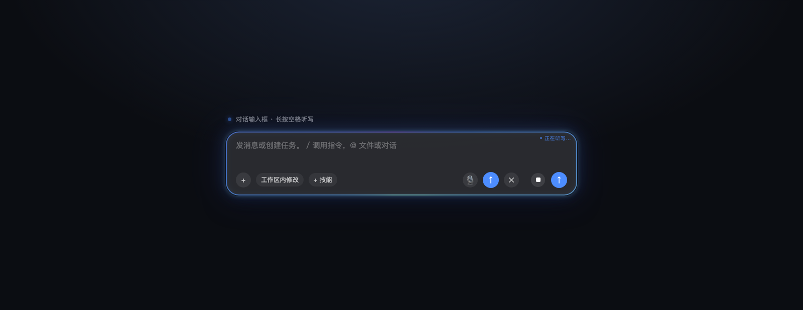
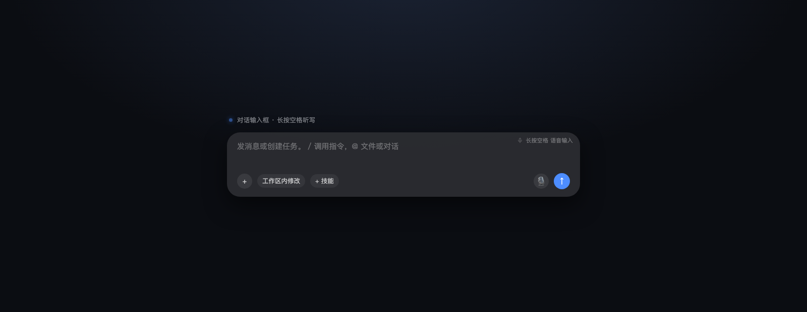

# dsh-voice-spacehold

给 [DeepSeek Harness](https://github.com/deepseek-ai/deepseek-harness) 的对话输入框加一层「**按住空格说话**」的手势：按住 0.5 秒开始听写，松手出字，`Esc` 丢弃。



它不录音、不联网、不接任何识别服务。语音输入本身由官方的实验性语音插件提供（SenseVoiceSmall，纯本地推理），
这个插件只做两件事：**替你去点那颗「听写」按钮**，以及**在输入框上画动效**。

## 它解决什么

官方语音插件已经有了听写能力，但入口是一颗小按钮：要先移鼠标、点一下、再点一下停。
打字时手一直在键盘上，缺的其实是「不用离开键盘」的入口。长按空格是最便宜的选择——
它不需要系统级热键（会和 Spotlight 的 `Cmd+Space` 抢），也不占用任何别的手势。

## 前置条件

| 需要 | 说明 |
| --- | --- |
| DeepSeek Harness | 建议 `0.2.1-rc.5` 或更新（本插件在 macOS 桌面端实测） |
| `@deepseek-ai/dsh-experimental-voice-input-bundle` | 提供「听写」按钮与本地 SenseVoiceSmall 识别。**没装也能装本插件**，只是长按时会提示「语音输入尚未就绪」 |
| 麦克风权限 | 首次听写时系统会问 |

## 安装

### 方式一：在 DSH 里装（推荐）

侧栏 **插件 → 安装**，填入：

```
github:HerixCarter/dsh-voice-spacehold
```

DSH 有 HMR 的话立刻生效，没有就重启一次。注意：页面里 `Cmd+R` **不会**重新加载插件代码，要完全退出 DSH（`Cmd+Q`）再启动。

### 方式二：手动 link（改代码时用）

```bash
git clone https://github.com/HerixCarter/dsh-voice-spacehold.git
ln -sfn "$PWD/dsh-voice-spacehold" ~/.dsh/profiles/<profile>/node_modules/dsh-voice-spacehold
```

然后在 `~/.dsh/profiles/<profile>/package.json` 里做两处登记：

```jsonc
{
  "dependencies": {
    "dsh-voice-spacehold": "link:/绝对路径/dsh-voice-spacehold"
  },
  "dsh": {
    "profile": {
      "bundles": ["...", "dsh-voice-spacehold"]   // 末尾追加
    }
  }
}
```

改完退出 DSH（`Cmd+Q`）再启动。`bash tools/doctor.sh` 可以确认装没装上。

## 用法

| 操作 | 结果 |
| --- | --- |
| 输入框内长按空格 ≥ 500ms | 开始听写；松手后识别结果插到**光标处**，不会自动发送 |
| 按住 150–500ms | `arming` 态：极淡内描边呼吸，让这 0.5 秒看起来是设计的一部分 |
| 听写中按 `Esc` | 丢弃本次结果，动效 150ms 内收起，输入框内容与听写前完全一致 |
| 短按 / 连按空格 | 正常输入空格，无动效、无残留 |
| 输入法组合中按空格（选词） | 完全不响应，不 preventDefault，正常选词 |
| 听写中切走窗口 / 页面隐藏 | 立即停止并收起动效 |
| 切到别的页面（输入框不在了） | 浮层整层收起，回到对话页自动恢复 |
| 麦克风不可用 | 边框转琥珀色 + 右上角「麦克风不可用」，2s 自动收起，照常打字 |
| 开屏动画 / 全屏弹层盖住输入框 | 浮层整层收起，不会飘在开屏画面上；露出来后自动恢复 |
| 输入框为空时 | 右上角一行弱化小字「长按空格 语音输入」；窄到放不下就只留一个小话筒图标（带底片，不挡字），一有内容就消失 |



**只对对话输入框生效**：设置页搜索框、重命名输入框等一律不响应。也没有任何全局热键。

## 动效三态

| 态 | 表现 |
| --- | --- |
| `idle` | 无 |
| `arming` | 内描边 1px，透明度 0.15→0.3，1.6s 呼吸 |
| `listening` | 2px 冷光描边（沿环青→蓝→紫渐变），0.35→0.7 呼吸；外圈三层光晕 + 内侧渗光；右上角「● 正在听写…」 |
| `warning` | 琥珀 `#f2b03d`，不呼吸，2s 收起 |

- 刻意不用红色：录音状态用红色会读成「报警」。
- 描边用 `conic-gradient` + 双层 `mask` 只留出「边」这一圈：颜色沿环渐变，比一条纯色线更像光。
- 光晕是三层不同半径的 `box-shadow`，只让 `opacity` 呼吸（不重绘几何），所以听写时不会掉帧。
- 没有假音效条：录音时原生插件自己会在输入框底部显示电平条，这里再画一排只会互相打架。
- 颜色是**硬编码**的，没走 `--dsw-alias-brand-primary` 这类主题变量：实测该变量在某些面板里取到空字符串，
  `var()` 拿到空值会让整条 `color` 声明失效、继承成正文白，边框就变成一个白圈。这个坑踩过，写在这里免得再踩。

## 实现

全部逻辑在 `lib/client.js`（浏览器侧，无依赖），宿主侧 `lib/index.js` 是空插件，只为占住 loader entry 让
`dsh.client` 声明能被扫到。

- **不自己启动录音**：长按到点后，找到原生「听写」按钮并 `click()`；松手点同一行里的 `停止并识别`；
  `Esc` 点第一个按钮（`取消`/`丢弃识别文字`）。原生插件的 `cancel()` 本来就不插入任何文字，
  所以「丢弃结果」是白拿的，不需要事后撤销插入。
- **按钮定位靠语义**：`aria-label` 命中 `开始录音`/`听写`/`Start recording`/`Dictate` 等，
  退路是 `[class*="_triggerAnchor"]`；活动态靠 `[data-voice-activity]` 的相位值。
- **按住期间不落空格**：第一次 keydown 就 `preventDefault()`，按住时一个空格都不会进草稿，
  到阈值时不需要回删。短按松手才补一个空格，走 Lexical 的 `editor.update(() => selection.insertText(' '))`，
  失败退 `execCommand('insertText')`，再失败退 Range + `InputEvent`。
- **输入法三重判断**：`event.isComposing` / `keyCode === 229` / 元素上的 composition 标记，任一命中就完全不响应。
- **事件在 document 捕获阶段判定**：用 `target.closest('[data-composer-input]')` 且再 `closest('[data-composer-card]')`
  确认真的是对话输入框，而不是靠先找到元素再绑事件——会话切换、输入框重建都自动跟上。
  也没有 `MutationObserver` 盯整棵 body。
- **浮层不跑每帧 rAF**：`ResizeObserver` + 400ms 兜底轮询贴框，位置没变就不写样式。
- **空识别后的重试**：识别为空时原生插件停在 `feedback` 态、触发按钮不渲染，插件会先点它的 dismiss 再重试，最多 4 次。
- **权限失败是推断的**：点完按钮 4s 内没进入 `recording` 就判为不可用，弹警示态。

调试把手：控制台里 `window.__dshVoiceSpacehold.state` 看状态机，`.insertSpace()` 手动测补空格。

## 已知限制

- 依赖原生语音插件的 **DOM 契约**（触发按钮的 `aria-label`、`[data-voice-activity]` 相位值、行内按钮顺序）。
  DSH 跨大版本升级可能改动它们，届时改 `lib/client.js` 顶部的 `TRIGGER_LABELS` 与选择器即可。
- 那个语音插件目前是**实验性**的（`@deepseek-ai/dsh-experimental-*`），它自己也可能变。
- 只对对话输入框生效；不做全局热键，不做悬浮按钮。
- 没有真实音量可视化（拿不到麦克风流）。

## 开发与测试

```bash
npm test          # 假 DOM 冒烟测试，19 项，不需要 DSH（CI 跑这个）
npm run check     # 语法检查 + 冒烟测试
bash tools/doctor.sh   # 装没装上：插件文件、符号链接、profile 两处登记
```

真机验证（可选，需要本机跑着 DSH）：

```bash
# 1. 从浏览器 DevTools → Application → Cookies 复制 dsh-auth-* 那一对
# 2. 用 Electron 加载真实页面跑 45 项断言
DSH_COOKIE="dsh-auth-xxxx=yyyy" \
DSH_URL="http://127.0.0.1:<port>" \
env -u ELECTRON_RUN_AS_NODE \
  ~/.dsh/electron/Electron.app/Contents/MacOS/Electron tools/probe.cjs
```

探针用假麦克风在真实 Lexical 编辑器 + 真实语音插件上跑完整验收，截图落在 `/tmp/dsvsh-shots/`。
它会往真实草稿里打字，**跑完会自动还原**。

## 卸载

```bash
# 插件页里卸载，或手动：
rm ~/.dsh/profiles/<profile>/node_modules/dsh-voice-spacehold
# 并从 profile/package.json 的 dependencies 与 dsh.profile.bundles 里删掉对应项
```

删掉目录即回滚：本插件没有改过 DSH 自身、原语音插件或任何其他插件的文件。

## DSH 升级之后

插件目录、profile 登记、符号链接都在 `~/.dsh` 和你的工作区里，升级替换的是 `/Applications/DeepSeek Harness.app`，
通常什么都不用做。真出问题按这个顺序查：

1. 长按空格试一次 —— 能用就不用管。
2. 完全退出 DSH（`Cmd+Q`）后重新打开。
3. `bash tools/doctor.sh` → 缺登记就按安装步骤补回去。
4. 全 ✅ 但页面没反应 → 跑 `tools/probe.cjs` 看哪条 FAIL：
   「找不到听写按钮」「原语音插件进入 recording」失败 = 原生插件的 DOM/文案变了；
   `window.__dshVoiceSpacehold` 是 undefined = 插件压根没被加载（清单机制变了）。

## English

A Space-Hold dictation gesture for the DeepSeek Harness composer. Hold `Space` for 500ms inside the
conversation input to start the built-in (local SenseVoiceSmall) dictation, release to stop, press `Esc`
to discard. It reuses the official experimental voice-input plugin by clicking its own buttons — no
recording, no network, no third-party STT — and only adds the gesture layer plus a three-state overlay
(1px arming glow / 2px gradient listening ring with a soft halo, "正在听写…" label).

Install: `github:HerixCarter/dsh-voice-spacehold` from the Plugins page, or symlink it into
`~/.dsh/profiles/<profile>/node_modules/` and register it in the profile manifest. Requires the
`@deepseek-ai/dsh-experimental-voice-input-bundle` for the actual dictation.

## License

MIT
